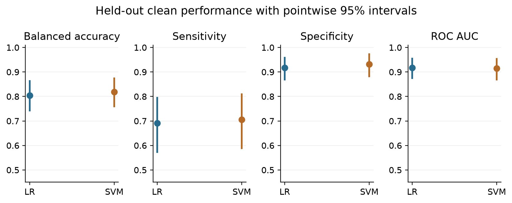
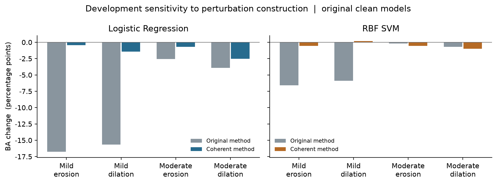
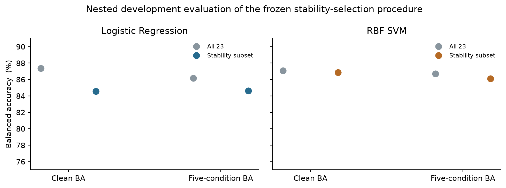
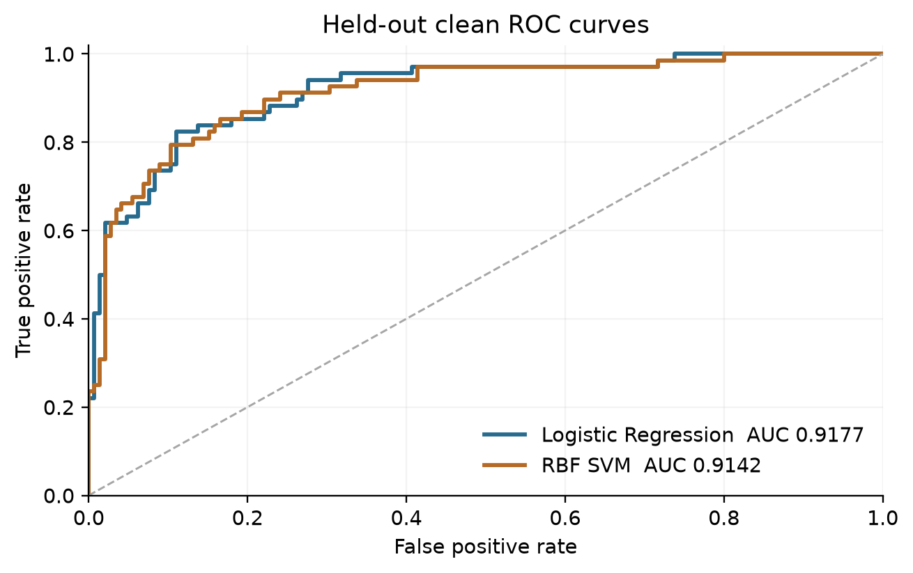
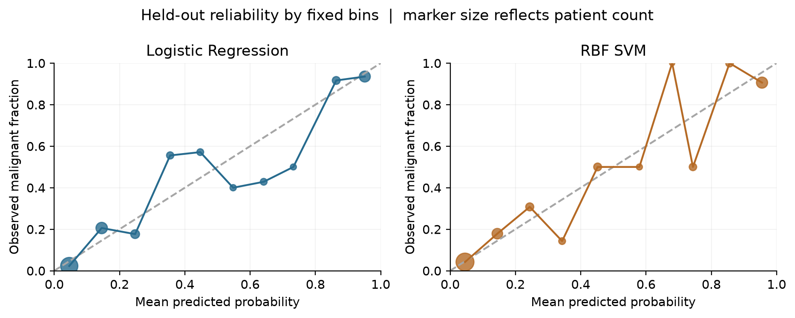
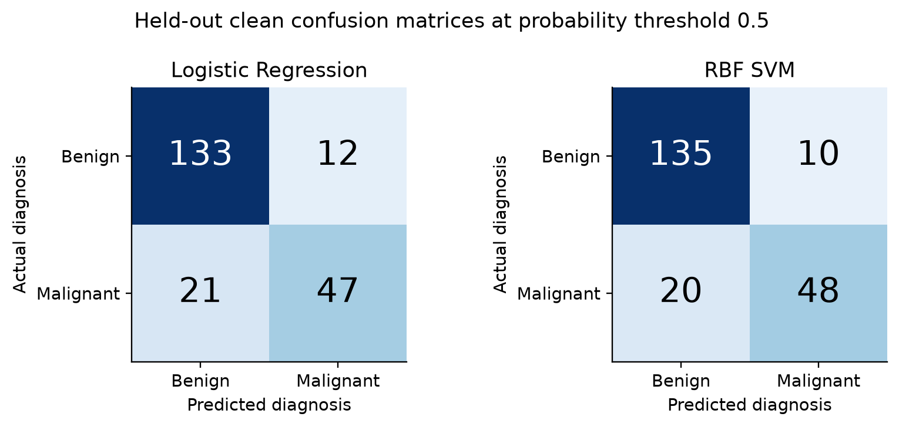
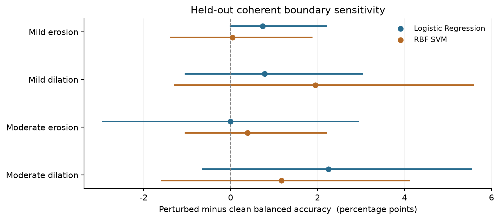

# Breast ultrasound classification under lesion boundary uncertainty

Mostafa Bdeir and Hadi Fardan

Final research report | 2026-11-15

## Study purpose and main findings

We studied how lesion-boundary changes affect breast-ultrasound classification using Logistic Regression (LR) and RBF SVM with 23 handcrafted features. The study includes 1,064 patients and separates development from a locked test cohort. All model selection and calibration decisions were completed before test predictions.

On 213 held-out patients, the primary SVM clean balanced accuracy was 81.85% (pointwise 95% interval 75.96-87.43%). LR achieved 80.42%. SVM had slightly higher sensitivity and specificity, while LR had slightly better AUC, Brier score and log loss. This is not a uniform superiority result.

The original mild erosion/dilation losses depended strongly on the perturbation mechanism. A separately labelled coherent alternative greatly reduced those losses on development data. The frozen stability-selection procedure did not improve the overall accuracy-robustness objective. Final held-out changes were small and sometimes raised balanced accuracy while worsening ranking or probability losses.

At the fixed 0.5 research threshold, SVM missed 20 of 68 malignant test patients. These results support a reproducible methodological study, not clinical deployment.

Figure 1. Clean held-out operating-point metrics and AUC. Bars show pointwise 95% patient-bootstrap intervals; all scores use a 0-1 axis.

## Dataset and evaluation design

BUS-BRA version 1.0 is the public dataset associated with Gomez-Flores, Gregorio-Calas and Pereira [1,2]. We classify benign versus malignant pathology using the provided lesion delineations. BI-RADS labels are not input features in this experiment.

The random seed is 42. Patients, rather than images, define the development/test separation and five locked outer folds. The original classifiers use three inner patient-stratified folds for tuning. Each patient contributes total training weight one across their views, with optional training-only class balancing. Patient scores average image scores.

Images are converted to grayscale and resized with preserved aspect ratio to longest side 256. Masks use nearest-neighbor interpolation. The 23 features comprise six shape, seven intensity and ten masked texture features. Masked GLCM pairs are counted only when both pixels lie inside the lesion, using distances one and three.

Shape features are area fraction, aspect ratio, eccentricity, solidity, extent and circularity. Intensity features are mean, SD, median, 10th and 90th percentiles, skewness and entropy. Texture features are contrast, dissimilarity, homogeneity, angular second moment and correlation at each of the two GLCM distances. The existing extractor fixes intensity normalization, quantization and direction averaging; its source fingerprint is preserved.

LR tunes C over 0.01, 0.1, 1, 10 and 100; RBF SVM tunes C over 0.1, 1 and 10 and gamma over scale, 0.01 and 0.1. Both consider class balancing off/on. The original inner objective is patient BA, with AUC and simpler settings as tie-breakers. Later robustness-oriented searches use the equal average of clean and four coherent BAs within each inner fold, then average over the three folds. The five-condition objective gives clean performance 20% of the total weight.

Clean scaling and classifier fitting never use perturbed training masks. Coherent inner-validation conditions may score the explicitly robustness-oriented candidate objective in later experiments. Final calibration uses additional patient-disjoint base/calibration splits. The held-out test is used once with frozen models, and reporting reuses its saved predictions.

| Cohort | Images | Patients | Benign | Malignant |
| --- | --- | --- | --- | --- |
| All patients | 1875 | 1064 | 722 | 342 |
| Development | 1514 | 851 | 577 | 274 |
| Held-out test | 361 | 213 | 145 | 68 |

## Original and coherent development robustness

The first experiment established clean nested patient-level baselines. The original boundary experiment then assessed eight mask conditions: mild/moderate erosion and dilation, plus four translations. Unavailable translated views were retained as unavailable; their patients were excluded only from the affected paired condition metrics.

Unexpectedly large mild-condition losses motivated a development diagnostic. Pseudo-random selection among boundary pixels could create scattered contour irregularities and change perimeter-dependent features. An independent coherent alternative grows localized, connected boundary edits; mild and moderate edits are nested. Their IoU targets are approximately 0.95 and 0.90.

The original results were preserved. Coherent masks were audited and their features extracted separately. Clean out-of-fold predictions reproduced for both classifiers before robustness scoring. The large original mild-condition BA losses shrank with coherent edits. This supports sensitivity to perturbation construction; it does not validate either mechanism as a realistic clinical annotation-error model.

The development patient-bootstrap intervals were exploratory and conditional on saved OOF fits and observed fold/diagnosis counts. They omitted retraining variability and did not establish a uniform SVM advantage. CV uncertainty requires particular caution because training sets overlap [4].

| Original clean baseline | BA (%) | AUC |
| --- | --- | --- |
| Logistic Regression | 86.89 | 0.9304 |
| RBF SVM | 87.07 | 0.9352 |

Figure 2. Original and coherent development BA changes for the same original clean-model procedure. This is a perturbation-construction comparison, not the final calibrated test model.

## Frozen stability feature selection experiment

Feature stability was ranked separately inside every inner training partition. Each condition's absolute image-feature shifts were averaged within patient and then equally across patients, normalized by clean training weighted SD. The score was the largest of the four condition means. Constant or near-constant features were excluded from subset candidates.

The frozen subset sizes were 5, 10 and 15. Both the subset arm and the all-23 comparator tuned the same model grids and the mean of clean plus four coherent patient BAs, averaged across three inner folds. Selected subsets were reranked on outer training patients before the outer refit. No global feature list or k was selected from outer results.

Both classifiers selected 15 features in each outer fold. The subset procedure did not improve the pooled five-condition objective. Its lower clean baseline can make relative BA-change comparisons look favorable even when absolute perturbed accuracy remains lower. This negative result is retained rather than altering the grid after inspecting outer outcomes.

| Model | Arm | Clean BA (%) | Five-condition BA (%) |
| --- | --- | --- | --- |
| Logistic Regression | All 23 | 87.35 | 86.15 |
| Logistic Regression | Stability subset | 84.55 | 84.63 |
| RBF SVM | All 23 | 87.07 | 86.69 |
| RBF SVM | Stability subset | 86.87 | 86.11 |

Figure 3. Matched nested development comparison. These are point estimates for the complete selection procedures; the plot does not imply statistical significance.

## Patient calibration and final protocol

The final procedure keeps all 23 features. SVM was designated primary from the Step 19 development five-condition objective; LR remains the comparator. This is a post-hoc development-based decision, not a significance claim. The sigmoid method, three-member ensemble and probability threshold 0.5 were fixed before calibration evaluation.

Within each outer training pool, each member reserves one of three patient folds for calibration. Its base model is independently tuned using three inner patient folds within the other two folds, then fitted only on clean base images. Calibration receives one clean score per reserved patient: logit of mean LR image probability, or mean SVM margin. A fixed regularized sigmoid with equal patient weights is fitted to those scores. This keeps base tuning, base fitting and calibration patients disjoint [3].

The patient calibrator uses StandardScaler followed by LogisticRegression with C=1, max_iter=2000 and random_state=42, without class or image-count weights. LR probabilities are clipped to [1e-6, 1-1e-6] before the logit. Calibration split seeds are 2020 plus scope code; base-tuning seeds are 3000 plus ten times scope code plus member index. Scope codes are 0-4 for outer evaluation and 5 for final fitting.

For prediction, image scores are aggregated within each member, calibrated at patient level, then the three probabilities are averaged. The same procedure fits the final development-only ensembles. Outer-validation patients influence none of its tuning, scaling, fitting or calibration operations.

Calibration quality is measured rather than assumed. At 0.5, outer development sensitivity fell and specificity rose relative to the earlier single-refit estimators. The ensemble has different member training sizes and settings, so cross-step differences cannot be attributed solely to the sigmoid. The threshold was not changed after observing this trade-off.

| Calibrated outer CV | BA (%) | Sensitivity (%) | Specificity (%) | Brier |
| --- | --- | --- | --- | --- |
| Logistic Regression | 84.16 | 72.99 | 95.32 | 0.0915 |
| RBF SVM | 84.73 | 75.18 | 94.28 | 0.0888 |

## Locked held out primary performance

The primary result is SVM clean BA 81.85% [75.96, 87.43]. The test cohort contains 145 benign and 68 malignant patients. Table intervals are pointwise percentiles from 10,000 shared patient resamples within diagnosis, seed 42, conditional on the frozen models.

The clean SVM-minus-LR BA difference is +1.42 percentage points [0.00, 3.29]. Its interval includes zero at the boundary. LR has the higher clean AUC and lower probability losses. The evidence does not support a universal claim that SVM is better on every measure.

The test is an internal patient hold-out from this dataset, not an independent external clinical cohort. Secondary intervals are not adjusted for multiple comparisons. No threshold, feature or model changes follow the test results.

| Metric | LR estimate [95% interval] | SVM estimate [95% interval] |
| --- | --- | --- |
| Balanced accuracy (%) | 80.42 [74.28, 86.26] | 81.85 [75.96, 87.43] |
| Sensitivity (%) | 69.12 [57.35, 79.41] | 70.59 [58.82, 80.88] |
| Specificity (%) | 91.72 [86.90, 95.86] | 93.10 [88.28, 97.24] |
| ROC AUC | 0.9177 [0.8747, 0.9547] | 0.9142 [0.8691, 0.9533] |
| Brier score | 0.1024 [0.0768, 0.1295] | 0.1030 [0.0761, 0.1321] |
| Log loss | 0.3296 [0.2594, 0.4060] | 0.3397 [0.2616, 0.4260] |

Figure 4. Clean test ROC curves from saved probabilities. AUC measures ranking over thresholds and differs from BA at the fixed operating point.

## Probability reliability and diagnostic errors

Clean Brier scores were 0.1024 for LR and 0.1030 for SVM; log losses were 0.3296 and 0.3397. Lower is better for these losses. Reliability bins summarize the same held-out probabilities, with sparse bins interpreted cautiously.

At 0.5, LR had 21 false negatives and 12 false positives. SVM had 20 false negatives and 10 false positives. SVM sensitivity was 70.59% and specificity 93.10%. AUC near 0.91 does not remove the missed-malignancy burden at this threshold.

Figure 5. Ten fixed-width reliability bins. Marker size reflects patient count; connecting lines do not establish reliable behavior in sparsely populated regions.

Figure 6. Frozen-threshold confusion matrices. Counts are patients, not individual image views.

## Held out coherent boundary sensitivity

Every test image had all four valid coherent feature vectors. All paired comparisons retain the same complete patients and image views. Positive signed BA change means a higher perturbed BA relative to that model's own clean baseline; it does not imply that segmentation errors are beneficial.

Some edits raise BA by moving a small number of scores across 0.5. At the same time, ranking AUC or probability losses can worsen. In particular, dilation reduces AUC for both classifiers in this test cohort. Report sensitivity, specificity, flips and probability quality alongside BA rather than interpreting one increase as global robustness.

New FN counts identify malignant patients correctly classified clean and missed after perturbation; recovered FN counts identify the reverse transition. Balanced accuracy can be unchanged despite individual errors moving between patients.

| Model | Condition | Delta BA (pp) | Flip (%) | New FN | Recovered FN |
| --- | --- | --- | --- | --- | --- |
| LR | Mild dilation | +0.78 | 1.88 | 0 | 2 |
| LR | Moderate dilation | +2.25 | 3.76 | 0 | 4 |
| LR | Mild erosion | +0.74 | 0.47 | 0 | 1 |
| LR | Moderate erosion | +0.00 | 1.88 | 2 | 2 |
| SVM | Mild dilation | +1.95 | 4.69 | 0 | 5 |
| SVM | Moderate dilation | +1.17 | 3.76 | 0 | 3 |
| SVM | Mild erosion | +0.05 | 1.41 | 0 | 1 |
| SVM | Moderate erosion | +0.39 | 0.94 | 0 | 1 |

Figure 7. Held-out perturbed-minus-clean BA changes with paired pointwise 95% intervals. Zero denotes no aggregate BA change, not zero individual prediction changes.

## Patient level failure analysis

There were 30 patients misclassified by both models, 3 misclassified by LR only, and 0 misclassified by SVM only; 180 were correct for both. The shared clean false-negative count was 20. These overlaps use the same saved patient predictions.

The example cases below are selected deterministically: up to three SVM false negatives with the lowest malignant probability, and up to three false positives with the highest probability. This is a descriptive confidence-error audit, not a blinded clinical review. The full CSV preserves every patient, image ID and per-model error flag.

No image-quality, lesion-subtype or scanner-specific cause is inferred from a probability alone. Such explanations require a separate qualified image review and appropriate metadata. Confidence in an incorrect prediction is a reliability concern, not proof of a particular biological mechanism.

The report preserves all failures and does not remove hard cases, optimize a new threshold, or revise the final model based on these test examples.

| Example category | Dataset case | Actual | LR probability | SVM probability |
| --- | --- | --- | --- | --- |
| SVM false negative | 434 | Malignant | 0.0402 | 0.0306 |
| SVM false negative | 78 | Malignant | 0.0385 | 0.0352 |
| SVM false negative | 459 | Malignant | 0.1727 | 0.0834 |
| SVM false positive | 427 | Benign | 0.9484 | 0.9592 |
| SVM false positive | 643 | Benign | 0.8765 | 0.9561 |
| SVM false positive | 966 | Benign | 0.9065 | 0.9407 |

## Computational cost and reproducibility

Fit counts document the cost of the complete procedures, including nested searches. Step 19 also used ten original-baseline reproducibility fits, separate from its twenty outer refits. The subset arm has an additional k search, so matched hyperparameter grids do not imply equal search budgets.

The final held-out evaluation performed zero model fits, zero calibrator fits and no retuning. The report likewise performs no model prediction or fitting: it recomputes descriptive metrics from saved predictions, verifies the completed evaluation marker and its published-file checksums, and inspects fitted model sizes without executing inference.

The final SVM ensemble contains 1303 support vectors across three members; the LR ensemble contains 69 base linear coefficients. The compressed combined model artifact is 0.22 MiB. These are structural/size counts, not a controlled inference-speed benchmark.

Only recorded runtimes are reported. Calibration and test runtimes were not retained; hardware-normalized speed, memory and energy comparisons cannot be reconstructed. Full input/output hashes, code fingerprints and provenance are supplied separately. The saved primary protocol and one-time evaluation marker remain unchanged.

| Stage | Inner base fits | Base refits | Sigmoid fits | Recorded seconds |
| --- | --- | --- | --- | --- |
| 19 nested feature selection | 1680 | 20 | 0 | 125.9 |
| 20 nested calibration and final fit | 1512 | 36 | 36 | Not recorded |
| 21 held-out evaluation | 0 | 0 | 0 | Not recorded |

## Limitations and conclusions

The data come from one public dataset. Patient separation prevents view leakage but does not establish scanner-, institution- or population-independent generalization. The study uses provided lesion masks; an end-to-end system with an automatic segmenter was not evaluated.

Boundary edits are synthetic and deterministic. Their IoU targets describe mask overlap, not guaranteed clinical plausibility. The large original mild-condition effect was mechanism-dependent, motivating a clearly labelled post-hoc coherent sensitivity analysis. Development-informed choices and diagnostics are not retrospective preregistration.

Stability selection was evaluated only for the frozen score, candidate sizes and objectives. Selecting 15 features in every fold does not justify expanding the grid after seeing these results. The negative finding does not prove that all stability-aware methods fail.

Calibration does not establish clinical risk validity. The fixed 0.5 threshold was not selected for clinical sensitivity, costs or workflow. The observed missed malignant patients preclude treating this report as a deployment recommendation. Uncertainty intervals are pointwise and conditional on the fixed fits and observed diagnosis composition; they do not include retraining or external-distribution variability.

The completed project supports three conclusions: perturbation construction materially affects measured boundary robustness; the frozen stability-subset procedure did not improve the overall development objective; and the frozen calibrated SVM attained the reported held-out BA with a substantial sensitivity limitation. LR retained small advantages on AUC and probability losses. These findings should be reported together, without claiming universal SVM superiority or changing the locked evaluation after inspection.

## References and project handoff

[1] Gomez-Flores W, Gregorio-Calas MJ, Pereira WCA. BUS-BRA: A Breast Ultrasound Dataset for Assessing Computer-aided Diagnosis Systems. Medical Physics. 2024;51:3110-3123. DOI: 10.1002/mp.16812.

[2] BUS-BRA version 1.0 dataset. Zenodo. https://zenodo.org/records/8231412. Dataset DOI: 10.5281/zenodo.8231412.

[3] Scikit-learn documentation. Probability calibration. https://scikit-learn.org/stable/modules/calibration.html. Also: Nested versus non-nested cross-validation, https://scikit-learn.org/stable/auto_examples/model_selection/plot_nested_cross_validation_iris.html.

[4] Bates S, Hastie T, Tibshirani R. Cross-validation: what does it estimate and how well does it do it? arXiv:2104.00673. https://arxiv.org/abs/2104.00673.

Scientific evaluation is complete. No further planned experiment remains. The remaining handoff is author review, any course-specific formatting or submission requirements, and preservation of the source code, frozen model/protocol, evaluation marker, saved results and report checksums. Future work requires a separately documented evaluation plan; it must not reuse this test set for tuning.
