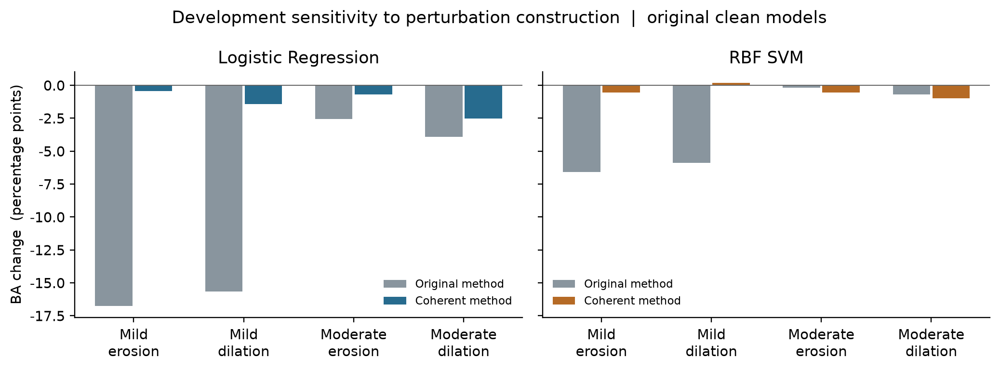
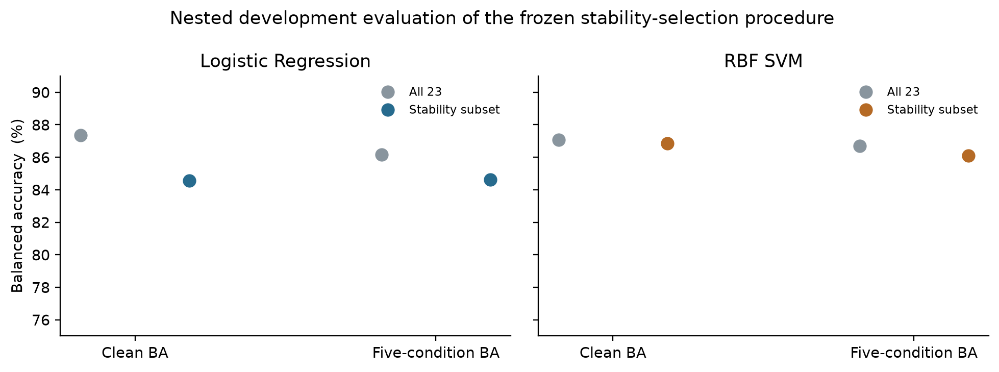
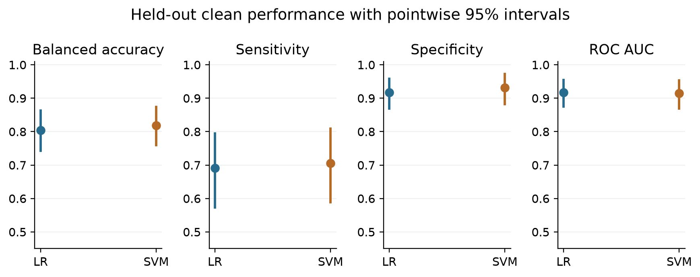
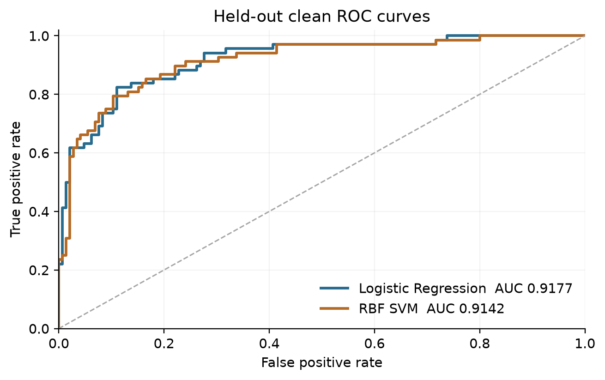
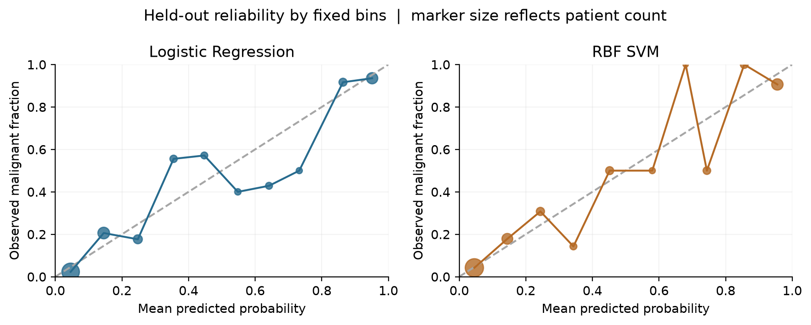
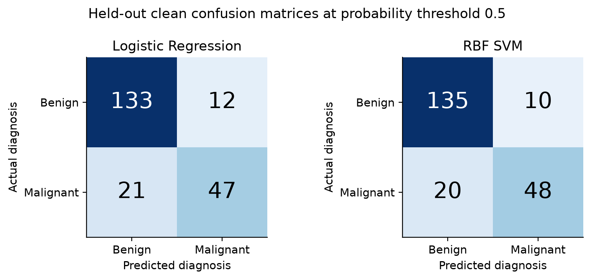
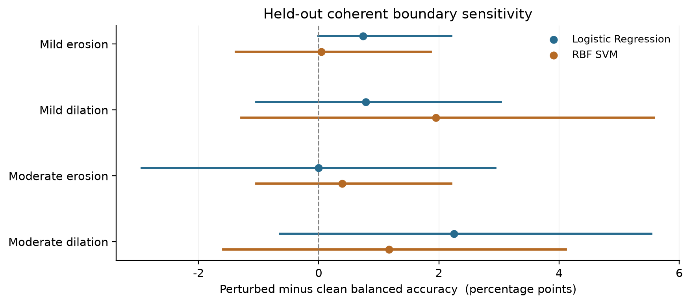

# Breast ultrasound classification under lesion boundary uncertainty

Mostafa Bdeir and Hadi Fardan

Final report | 2026-11-20 | Code, tests, saved results and the trained model: <https://github.com/mostafabdeir0/busbra-robustness>

## Abstract

Computer-aided diagnosis of breast ultrasound lesions often starts from an outlined lesion, but outlines are imperfect. We study how small changes to the lesion boundary affect benign-versus-malignant classification on BUS-BRA (1,875 images from 1,064 patients), using 23 handcrafted shape, intensity and masked-texture features and two classifiers on identical inputs: a tuned L2 logistic regression (LR) and a tuned RBF support vector machine (SVM). Evaluation is patient-level throughout: nested grouped cross-validation, patient-level probability calibration, and one locked hold-out of 213 patients scored once.

On the hold-out, the calibrated SVM reached balanced accuracy 81.85% (95% interval 75.96-87.43) against 80.42% for LR. The paired difference of +1.42 points has an interval of [0.00, 3.29], three more patients were classified correctly, and LR had slightly better AUC and probability losses, so the evidence does not support preferring the SVM by default. In a single-fold timing of one tuned base model each, fitting and prediction took milliseconds for both, so per-fit compute is not the SVM's main cost; its costs are a larger tuning grid (18 against 10 candidates), a larger model (about 60 times larger for one compressed base model) and lower interpretability. At the fixed 0.5 threshold the SVM missed 20 of 68 malignant patients. In a descriptive, development-only analysis, thresholds chosen for 90% sensitivity on the other development folds gave 90.1% sensitivity and 82.7% specificity for the SVM, against 75.2% and 94.3% at 0.5; this estimate is not fully independent of the folds it was applied to, and it has not been evaluated on the test set.

Measured boundary sensitivity depended strongly on how the boundary edits were built. Under our first, pixel-scattering construction, development balanced accuracy fell by 16.8 and 15.7 points for LR under mild erosion and dilation, against 6.6 and 5.9 points for the SVM, so the nonlinear model was less sensitive, not more. A spatially coherent alternative shrank all these losses to at most 2.5 points. A training-only stability feature-selection procedure, compared with a matched all-feature model, did not improve the development accuracy-robustness objective.

## 1. Introduction

### 1.1 Motivation

Breast ultrasound is widely used to characterize suspicious lesions, and computer-aided diagnosis systems aim to help separate benign from malignant findings [11]. Many of them work in two stages: a lesion is first delineated, by a radiologist or an automatic method [12], and a classifier then describes and labels the outlined region. Handcrafted shape and texture descriptors computed inside the outline have a long history in this setting [5, 8], and they make the classifier depend on the boundary: the same ultrasound image gives different features when the contour moves. Studies in CT and breast MRI have shown that radiomic features can change under image perturbation and under different manual delineations [6, 7], but classifiers are usually evaluated on a single fixed set of reference masks.

Our task starts from an identified, outlined lesion. It is not whole-image cancer detection, and the masks are the dataset's provided expert masks.

### 1.2 Research question

Following the approved proposal: *Do nonlinear classifiers improve breast-lesion classification while becoming more sensitive to imperfect lesion boundaries, and can stable-feature selection reduce that sensitivity without sacrificing clean-data performance?*

### 1.3 Approach

We use BUS-BRA v1.0 [1, 2], which has biopsy-based labels, expert lesion masks and several images per patient for many patients. All splits are by patient. From each image and mask we compute 23 fixed descriptors (six shape, seven intensity, ten masked texture). The model ladder has two levels on identical inputs. Level 1 is L2-regularized logistic regression. Level 2 is an RBF-kernel SVM [13], which can represent nonlinear relationships between the same features and is the smallest step up that isolates model flexibility from feature choice. Both are tuned by nested patient-grouped cross-validation and calibrated at the patient level [9]. A 20% patient hold-out is scored once with frozen models, and intervals use paired patient-level bootstrap resampling [10].

Three experiments follow the proposal: (1) a clean-mask comparison of LR and SVM; (2) a boundary-sensitivity stress test with synthetic erosion, dilation and translation of the mask, models fixed; (3) a mitigation experiment that selects features by stability under boundary edits, using training data only, and compares the result with a matched all-feature model.

### 1.4 Findings in brief

- The calibrated SVM scored slightly higher than LR on held-out balanced accuracy (81.85% against 80.42%) but not clearly so, and LR was better on AUC, Brier score and log loss.
- Boundary sensitivity depended on the edit construction. Under the original construction the SVM lost less accuracy than LR; under the coherent construction both lost little.
- Stability selection did not help, and the final models keep all 23 features.
- The SVM missed 20 of 68 malignant test patients at the fixed threshold. This is a methodological study, not a deployment recommendation.
- On development data, a lower threshold aimed at 90% sensitivity cut missed cancers by more than half, at the cost of about three times as many false alarms (descriptive analysis, Section 4.8).

### 1.5 Contributions

1. A leakage-controlled, patient-level pipeline with frozen protocols and a single locked hold-out evaluation.
2. A paired linear-versus-nonlinear comparison on the same handcrafted features, with uncertainty intervals, calibration, and a measured account of cost.
3. Evidence that measured boundary sensitivity can be dominated by how the perturbation is constructed, with both constructions reported.
4. A negative result for training-only stability feature selection under a matched comparator.
5. A development pipeline that was rerun from the raw archive and reproduced every deterministic development result and the final model file exactly (Section 6); only timings vary between runs.

## 2. Dataset

BUS-BRA version 1.0 is the public dataset of Gomez-Flores, Gregorio-Calas and Pereira [1, 2]. We classify benign versus malignant pathology using the provided lesion delineations. BI-RADS labels, patient identifiers and scanner metadata are not model inputs. The 1,875 image-mask pairs and 1,064 patients were checked on download (no empty or non-binary masks, no image-mask size mismatches; four CSV-versus-image dimension discrepancies were noted and are non-blocking).

| Cohort | Images | Patients | Benign | Malignant |
| --- | --- | --- | --- | --- |
| All patients | 1875 | 1064 | 722 | 342 |
| Development | 1514 | 851 | 577 | 274 |
| Held-out test | 361 | 213 | 145 | 68 |

*Table 1.* Cohorts after the patient-level split.

The random seed is 42. Patients, not images, define the 80/20 development/test separation and five locked outer folds. Images are converted to grayscale and resized with preserved aspect ratio to a longest side of 256 pixels; masks use nearest-neighbor interpolation.

## 3. Models and methods

### 3.1 Features

The 23 features comprise six shape (area fraction, aspect ratio, eccentricity, solidity, extent, circularity), seven intensity (mean, SD, median, 10th and 90th percentiles, skewness, entropy) and ten masked texture features (contrast, dissimilarity, homogeneity, angular second moment and correlation at gray-level co-occurrence distances one and three [8]). Masked co-occurrence pairs are counted only when both pixels lie inside the lesion. The extractor fixes intensity normalization, quantization to 32 levels and averaging over four directions.

### 3.2 Models and tuning

Logistic regression is the classical baseline: it is regularized, interpretable through its coefficients, and strong on small tabular feature sets. The RBF SVM is the Level 2 model. LR tunes C over 0.01, 0.1, 1, 10 and 100 (10 candidates with class balancing off or on). The SVM tunes C over 0.1, 1 and 10 and gamma over scale, 0.01 and 0.1 (18 candidates with balancing off or on). Each patient contributes total training weight one across their views, with optional class balancing, and patient scores average the image scores. Scaling and fitting use training folds only. The original inner objective is patient balanced accuracy (BA), with AUC and simpler settings as tie-breakers.

The settings chosen in each outer fold of the original baselines were:

| Model | Outer fold | C | gamma | Class balancing | Outer-fold BA (%) |
| --- | --- | --- | --- | --- | --- |
| LR | 0 | 100 | - | on | 83.5 |
| LR | 1 | 10 | - | on | 84.6 |
| LR | 2 | 100 | - | on | 88.0 |
| LR | 3 | 1 | - | on | 89.4 |
| LR | 4 | 1 | - | on | 88.9 |
| SVM | 0 | 1 | scale | on | 85.4 |
| SVM | 1 | 1 | 0.01 | on | 85.9 |
| SVM | 2 | 10 | 0.01 | on | 89.3 |
| SVM | 3 | 1 | scale | on | 86.2 |
| SVM | 4 | 1 | scale | on | 88.4 |

*Table 2.* Hyperparameters chosen in each outer fold of the original baselines.

The final calibrated ensembles each have three members (Section 3.6) with the following selected settings. LR: (C=0.1, balanced), (C=10, unbalanced), (C=0.1, balanced). SVM: (C=1, gamma=scale, balanced), (C=10, gamma=0.01, balanced), (C=1, gamma=0.01, balanced).

### 3.3 Validation protocol

Development uses five locked outer patient folds and three inner patient-stratified folds for tuning (nested cross-validation [3]). Clean scaling and classifier fitting never use perturbed training masks. The 20% test cohort is untouched until the frozen models are scored once. The final calibration uses additional patient-disjoint base and calibration splits.

### 3.4 Boundary-edit constructions

Eight predefined conditions were used on development data: mild and moderate erosion and dilation (targeting intersection-over-union of about 0.95 and 0.90 with the original mask) and shifts of the mask left, right, up and down (about 0.90). The **original construction** erodes or dilates by choosing boundary pixels in order of distance to the contour, with a pseudo-random tie-break, which can scatter isolated pixel changes around the contour. After this produced unexpectedly large mild-condition losses, we added a **coherent construction** that grows a single connected patch near one contour anchor; mild and moderate edits are nested. The original results were preserved, and the coherent analysis is labeled post hoc. Neither construction is validated as a model of real annotation error.

### 3.5 Stability feature selection (and how stability was balanced against accuracy)

Stability was ranked separately inside every training partition, never on validation or test patients. For each of the four coherent edits we measured each feature's absolute change per image, averaged within patient and then across patients, and divided by the clean training standard deviation. A feature's stability score is the largest of its four condition scores (lower is better). Stability alone does not make a feature informative, so ranking only proposes candidates: for subset sizes of 5, 10 and 15, and for an all-23 comparator, the model grids were tuned with an objective that gives clean BA and the four perturbed BAs equal weight, averaged over three inner folds. Clean performance therefore carries one fifth of the objective, so the procedure can trade some clean accuracy for stability, and the nested results measure that trade. Subsets were reranked on outer training patients before each outer refit; no global feature list was used.

### 3.6 Probability calibration

Within each outer training pool, each of three ensemble members reserves one of three patient folds for calibration. Its base model is tuned on the other two folds and fitted only on clean base images. Calibration receives one clean score per reserved patient (the logit of the mean LR image probability, or the mean SVM margin), and a regularized sigmoid [9] (standardizer followed by logistic regression, C=1) is fitted to those scores. Base tuning and base fitting use only that member's base patients; its calibration patients are disjoint from them, and the outer-validation patients are disjoint from both [3]. At prediction time, image scores are aggregated within each member, calibrated at patient level, and the three probabilities are averaged. The decision threshold is fixed at 0.5.

### 3.7 Deviations from the proposal

The table below lists what the approved proposal said, what was done, why, and whether the decision preceded access to the test set.

| Proposed | Final procedure | Reason | Before test access? |
| --- | --- | --- | --- |
| Mean balanced-accuracy drop under eight predefined masks is the primary endpoint of the stress test | The headline held-out result is clean SVM balanced accuracy; boundary sensitivity is reported per condition with paired intervals | SVM was designated primary from the development five-condition objective. This is a post-hoc, development-based choice, not a significance claim | Yes: protocol frozen before the held-out evaluation |
| Eight boundary conditions: erosion, dilation, translation | All eight were assessed on development data. The held-out evaluation used the four erosion and dilation conditions | Later stages require complete paired coverage for every patient, which erosion and dilation provide and translations do not (849 and 841 of 851 development patients had valid left and right shifts) | Yes |
| One edit construction per condition | A second, coherent construction was added; both are reported | The first construction produced unexpectedly large mild-condition losses; the diagnosis pointed to scattered pixel changes | Yes (post-hoc development diagnostic) |
| Operating threshold chosen in grouped cross-validation | Fixed threshold of 0.5, not tuned, for every reported test result. An exploratory development-only threshold analysis was added afterwards (Section 4.8) | The protocol fixes 0.5 as a research threshold and forbids switching methods after seeing outer results, so that the operating point is not chosen after the sensitivity-specificity trade-off is visible | Yes for the 0.5 threshold; the exploratory analysis came after the test results |
| Calibration and confidence reliability | Patient-level sigmoid calibration in a three-member ensemble whose calibration patients are disjoint from the base patients used for tuning and fitting | Keeps calibration free of leakage from tuning and outer-validation patients | Yes |
| Stable features chosen from development data, then retrain (Experiment 3) | Frozen nested procedure with k in {5, 10, 15} and a matched all-23 comparator | A matched comparator attributes any change to feature selection | Yes: design frozen first; result negative |
| Runtime and confidence in Experiment 1 | Development-only timing benchmark (Section 4.9) | Runtimes were not retained for the calibration or test stages of the original run | Not applicable |
| Level 2 comparison subject to instructor approval; the feedback suggested an optional CNN | RBF SVM as Level 2; no CNN | A CNN would need its own perturbed-crop protocol and could not be scored on the locked test set without a new protocol (Section 5) | Not applicable |

*Table 3.* Deviations from the approved proposal.

Order of decisions: data audit and patient splits; clean features; LR and SVM baselines; original eight-condition stress test; diagnosis and coherent alternative; frozen stability design; nested stability evaluation; calibration and final protocol freeze; one locked held-out evaluation; report from saved predictions. Original step numbers are listed in the appendix.

## 4. Results

### 4.1 Clean development baselines

The first experiment established clean nested patient-level baselines on development data.

| Original clean baseline | BA (%) | AUC |
| --- | --- | --- |
| Logistic Regression | 86.89 | 0.9304 |
| RBF SVM | 87.07 | 0.9352 |

*Table 4.* Original clean development baselines.

Fold-to-fold variation of the calibrated development predictions shows how sensitive conclusions are to the split. Across the five outer folds, the standard deviation of balanced accuracy is 2.0 points for LR and 2.9 for the SVM (ranges of 5.0 and 7.2 points), larger than the 0.6-point gap between the two classifiers' means:

| Model | Mean BA (%) | SD across folds (pp) | Min (%) | Max (%) |
| --- | --- | --- | --- | --- |
| LR | 84.15 | 2.02 | 81.9 | 87.0 |
| SVM | 84.71 | 2.88 | 80.3 | 87.4 |

*Table 5.* Fold-to-fold variation of calibrated development balanced accuracy (SD = standard deviation).

### 4.2 Boundary sensitivity on development data

| Model | Condition | Patients | Delta BA (pp) | Flip (%) | New FN | Recovered FN |
| --- | --- | --- | --- | --- | --- | --- |
| LR | Mild erosion | 851 | -16.77 | 31.6 | 1 | 24 |
| LR | Mild dilation | 851 | -15.66 | 30.0 | 2 | 24 |
| LR | Moderate erosion | 851 | -2.57 | 9.4 | 4 | 17 |
| LR | Moderate dilation | 851 | -3.92 | 9.5 | 5 | 12 |
| LR | Shift left | 849 | -0.78 | 2.0 | 3 | 3 |
| LR | Shift right | 841 | -0.59 | 1.5 | 0 | 2 |
| LR | Shift up | 851 | -0.75 | 3.5 | 2 | 5 |
| LR | Shift down | 851 | -0.34 | 2.9 | 3 | 4 |
| SVM | Mild erosion | 851 | -6.58 | 16.3 | 0 | 19 |
| SVM | Mild dilation | 851 | -5.90 | 14.8 | 1 | 19 |
| SVM | Moderate erosion | 851 | -0.18 | 4.9 | 2 | 11 |
| SVM | Moderate dilation | 851 | -0.71 | 5.5 | 3 | 11 |
| SVM | Shift left | 849 | +0.02 | 1.2 | 0 | 2 |
| SVM | Shift right | 841 | +0.04 | 1.1 | 0 | 3 |
| SVM | Shift up | 851 | +0.21 | 1.6 | 1 | 5 |
| SVM | Shift down | 851 | +0.00 | 1.6 | 4 | 4 |

*Table 6.* Original construction, eight conditions, development data (patient-level paired changes relative to each model's own clean baseline; "Flip" is the share of patients whose predicted class changed).

Under the original construction, mild erosion and dilation cost LR 16.8 and 15.7 balanced-accuracy points and flipped about 30% of its predictions, against 6.6 and 5.9 points and about 15-16% for the SVM. Moderate edits and all translations were much smaller for both models (LR up to 3.9 points; SVM up to 0.7 points). The coherent construction produced much smaller changes for both models:

| Model | Condition | Delta BA (pp) | Flip (%) | New FN | Recovered FN |
| --- | --- | --- | --- | --- | --- |
| LR | Mild erosion | -0.45 | 2.0 | 4 | 2 |
| LR | Mild dilation | -1.43 | 5.2 | 1 | 6 |
| LR | Moderate erosion | -0.71 | 3.1 | 5 | 3 |
| LR | Moderate dilation | -2.54 | 7.8 | 2 | 8 |
| SVM | Mild erosion | -0.56 | 1.9 | 4 | 0 |
| SVM | Mild dilation | +0.18 | 3.9 | 1 | 11 |
| SVM | Moderate erosion | -0.55 | 2.7 | 4 | 1 |
| SVM | Moderate dilation | -0.98 | 5.4 | 4 | 10 |

*Table 7.* Coherent construction, development data.

Figure 1. Original and coherent development BA changes for the same original clean-model procedure. This is a perturbation-construction comparison, not the final calibrated test model.

**Answer to the research question, kept condition-specific.** Under the original construction on development data, the SVM was less sensitive than LR, not more. This is not a general claim about nonlinear models: the gap shrank under the coherent construction, the final calibrated models differ from the ones in this experiment, and on the locked test set the paired changes under coherent edits were small for both models (Section 4.7). Our evidence therefore does not support the hypothesis that the nonlinear model is more boundary-sensitive, and it does not support the opposite as a general statement.

The large original losses are mechanism-dependent: scattered pixel changes alter perimeter-dependent features. This supports sensitivity to how a perturbation is constructed; it does not validate either construction as a realistic clinical annotation-error model. Development bootstrap intervals were exploratory, conditional on saved out-of-fold fits, and omit retraining variability; cross-validation uncertainty needs particular caution because training sets overlap [4].

### 4.3 Stability feature selection (mitigation experiment)

Both the subset arm and the all-23 comparator tuned the same grids and the same objective (mean of clean plus four coherent patient BAs, averaged over three inner folds).

| Model | Arm | Clean BA (%) | Five-condition BA (%) |
| --- | --- | --- | --- |
| Logistic Regression | All 23 | 87.35 | 86.15 |
| Logistic Regression | Stability subset | 84.55 | 84.63 |
| RBF SVM | All 23 | 87.07 | 86.69 |
| RBF SVM | Stability subset | 86.87 | 86.11 |

*Table 8.* Matched nested comparison of the stability subset and the all-23 arm (development).

Figure 2. Matched nested development comparison. These are point estimates for the complete selection procedures; the plot does not imply statistical significance.

The subset procedure did not improve the pooled five-condition objective, and its lower clean accuracy can make relative BA-change comparisons look favorable even when absolute perturbed accuracy stays lower. Both classifiers selected 15 features in every outer fold, and the rankings were identical for the two classifiers because stability scoring does not use the classifier. Fourteen features were selected in all five folds; shape extent was selected in four folds and shape axis ratio in one. Seven features were never selected: intensity SD, skewness, entropy and 90th percentile, texture correlation at both distances, and contrast at distance three.

| Feature | LR folds selected (of 5) | SVM folds selected (of 5) |
| --- | --- | --- |
| glcm_asm_d1 | 5 | 5 |
| glcm_asm_d3 | 5 | 5 |
| glcm_contrast_d1 | 5 | 5 |
| glcm_dissimilarity_d1 | 5 | 5 |
| glcm_dissimilarity_d3 | 5 | 5 |
| glcm_homogeneity_d1 | 5 | 5 |
| glcm_homogeneity_d3 | 5 | 5 |
| int_mean | 5 | 5 |
| int_median | 5 | 5 |
| int_p10 | 5 | 5 |
| shape_area_fraction | 5 | 5 |
| shape_circularity | 5 | 5 |
| shape_eccentricity | 5 | 5 |
| shape_solidity | 5 | 5 |
| shape_extent | 4 | 4 |
| shape_axis_ratio | 1 | 1 |
| glcm_contrast_d3 | 0 | 0 |
| glcm_correlation_d1 | 0 | 0 |
| glcm_correlation_d3 | 0 | 0 |
| int_entropy | 0 | 0 |
| int_p90 | 0 | 0 |
| int_skewness | 0 | 0 |
| int_std | 0 | 0 |

*Table 9.* Number of outer folds in which each feature was selected by the stability procedure.

The negative finding applies to this frozen score, candidate sizes and objective; it does not show that all stability-aware methods fail.

### 4.4 Calibrated development performance

At 0.5, calibrated outer-fold sensitivity fell and specificity rose relative to the earlier single-refit estimators. The ensemble has different member training sizes and settings, so cross-step differences cannot be attributed only to the sigmoid. The threshold was not changed after this trade-off was observed.

| Calibrated outer CV | BA (%) | Sensitivity (%) | Specificity (%) | Brier |
| --- | --- | --- | --- | --- |
| Logistic Regression | 84.16 | 72.99 | 95.32 | 0.0915 |
| RBF SVM | 84.73 | 75.18 | 94.28 | 0.0888 |

*Table 10.* Calibrated outer-fold development performance at threshold 0.5.

### 4.5 Locked held-out performance

The test cohort contains 145 benign and 68 malignant patients. Intervals are pointwise percentiles from 10,000 shared patient resamples within diagnosis (seed 42), conditional on the frozen models [10].

| Metric | LR estimate [95% interval] | SVM estimate [95% interval] |
| --- | --- | --- |
| Balanced accuracy (%) | 80.42 [74.28, 86.26] | 81.85 [75.96, 87.43] |
| Sensitivity (%) | 69.12 [57.35, 79.41] | 70.59 [58.82, 80.88] |
| Specificity (%) | 91.72 [86.90, 95.86] | 93.10 [88.28, 97.24] |
| ROC AUC | 0.9177 [0.8747, 0.9547] | 0.9142 [0.8691, 0.9533] |
| Brier score | 0.1024 [0.0768, 0.1295] | 0.1030 [0.0761, 0.1321] |
| Log loss | 0.3296 [0.2594, 0.4060] | 0.3397 [0.2616, 0.4260] |

*Table 11.* Locked held-out results with pointwise 95% patient-bootstrap intervals.

Figure 3. Clean held-out operating-point metrics and AUC. Bars show pointwise 95% patient-bootstrap intervals; the displayed vertical scale is shared across panels.

Figure 4. Clean test ROC curves from saved probabilities. AUC measures ranking over thresholds and differs from BA at the fixed operating point.

**What the SVM improves, and what that costs (Level 2 verdict).** The SVM's clean BA is 1.42 points higher (paired interval [0.00, 3.29]), and it classified three more of the 213 patients correctly. LR had the better AUC, Brier score and log loss. The improvement is therefore small and not distinguishable from noise at this sample size. Per-fit compute is negligible for both models in our single-fold timing (Section 4.9), so the cost lies elsewhere: a tuning grid of 18 rather than 10 candidates (which multiplies the nested-search cost), a single compressed base model about 60 times larger, and a decision function that cannot be read off coefficients as LR's can. On this evidence the SVM's advantage does not justify preferring it by default; the simpler LR is the better default unless a larger evaluation shows a clear gain.

The test is an internal patient hold-out, not an independent external clinical cohort. Secondary intervals are not adjusted for multiple comparisons. No threshold, feature or model changes followed the test results.

### 4.6 Probability reliability and diagnostic errors

At 0.5, LR had 21 false negatives and 12 false positives; the SVM had 20 and 10. SVM sensitivity was 70.59% and specificity 93.10%. An AUC near 0.91 does not remove the missed-malignancy burden at this threshold.

Figure 5. Ten fixed-width reliability bins. Marker size reflects patient count; connecting lines do not establish reliable behavior in sparsely populated regions.

Figure 6. Frozen-threshold confusion matrices. Counts are patients, not individual image views.

### 4.7 Held-out boundary sensitivity (coherent edits)

Every test image had all four valid coherent feature vectors, and all paired comparisons keep the same patients and views. A positive change means higher perturbed BA relative to the model's own clean baseline; it does not imply that segmentation errors are beneficial. Some edits raise BA by moving a small number of scores across 0.5 while ranking AUC or probability losses worsen: dilation lowers AUC for both classifiers in this cohort.

| Model | Condition | Delta BA (pp) | Flip (%) | New FN | Recovered FN |
| --- | --- | --- | --- | --- | --- |
| LR | Mild dilation | +0.78 | 1.88 | 0 | 2 |
| LR | Moderate dilation | +2.25 | 3.76 | 0 | 4 |
| LR | Mild erosion | +0.74 | 0.47 | 0 | 1 |
| LR | Moderate erosion | +0.00 | 1.88 | 2 | 2 |
| SVM | Mild dilation | +1.95 | 4.69 | 0 | 5 |
| SVM | Moderate dilation | +1.17 | 3.76 | 0 | 3 |
| SVM | Mild erosion | +0.05 | 1.41 | 0 | 1 |
| SVM | Moderate erosion | +0.39 | 0.94 | 0 | 1 |

*Table 12.* Held-out paired changes under the coherent edits.

Figure 7. Held-out perturbed-minus-clean BA changes with paired pointwise 95% intervals. Zero denotes no aggregate BA change, not zero individual prediction changes.

### 4.8 Failure analysis

**Where errors concentrate (development, calibrated out-of-fold predictions).** We split patients by mean lesion size (tertiles of the mean area fraction of their images) and by number of views.

| Model | Class | Factor | Group | Patients | Errors | Error rate (%) |
| --- | --- | --- | --- | --- | --- | --- |
| LR | Benign | Lesion size | large | 131 | 15 | 11.5 |
| LR | Benign | Lesion size | middle | 192 | 7 | 3.6 |
| LR | Benign | Lesion size | small | 254 | 5 | 2.0 |
| LR | Malignant | Lesion size | large | 153 | 37 | 24.2 |
| LR | Malignant | Lesion size | middle | 91 | 24 | 26.4 |
| LR | Malignant | Lesion size | small | 30 | 13 | 43.3 |
| SVM | Benign | Lesion size | large | 131 | 16 | 12.2 |
| SVM | Benign | Lesion size | middle | 192 | 11 | 5.7 |
| SVM | Benign | Lesion size | small | 254 | 6 | 2.4 |
| SVM | Malignant | Lesion size | large | 153 | 34 | 22.2 |
| SVM | Malignant | Lesion size | middle | 91 | 22 | 24.2 |
| SVM | Malignant | Lesion size | small | 30 | 12 | 40.0 |
| LR | Benign | Views per patient | 1 | 131 | 5 | 3.8 |
| LR | Benign | Views per patient | 2 | 446 | 22 | 4.9 |
| LR | Malignant | Views per patient | 1 | 57 | 18 | 31.6 |
| LR | Malignant | Views per patient | 2 | 217 | 56 | 25.8 |
| SVM | Benign | Views per patient | 1 | 131 | 4 | 3.1 |
| SVM | Benign | Views per patient | 2 | 446 | 29 | 6.5 |
| SVM | Malignant | Views per patient | 1 | 57 | 18 | 31.6 |
| SVM | Malignant | Views per patient | 2 | 217 | 50 | 23.0 |

*Table 13.* Development out-of-fold error rates by lesion size and number of views.

Malignant lesions in the smallest size tertile were missed most often (40-43%, but only 30 patients, so this is imprecise), and large benign lesions were most often called malignant (11.5-12.2%). Malignant patients with a single view were missed more often than those with two views (31.6% against 23.0-25.8%). These are descriptive associations within development data; we infer no biological cause from them.

**Held-out confidence errors.** Thirty held-out patients were misclassified by both models, three by LR only and none by the SVM only; 180 were correct for both, and 20 malignant patients were missed by both. The six most confident errors (lowest-probability SVM false negatives and highest-probability false positives, chosen deterministically) are listed below. This is a descriptive audit, not a blinded clinical review, and no image-quality, subtype or scanner cause is inferred from a probability alone.

| Example category | Dataset case | Actual | LR probability | SVM probability |
| --- | --- | --- | --- | --- |
| SVM false negative | 434 | Malignant | 0.0402 | 0.0306 |
| SVM false negative | 78 | Malignant | 0.0385 | 0.0352 |
| SVM false negative | 459 | Malignant | 0.1727 | 0.0834 |
| SVM false positive | 427 | Benign | 0.9484 | 0.9592 |
| SVM false positive | 643 | Benign | 0.8765 | 0.9561 |
| SVM false positive | 966 | Benign | 0.9065 | 0.9407 |

*Table 14.* The six most confident held-out errors.

**Mitigations.** The boundary-sensitivity failure mode was addressed with stability-based feature selection (Section 4.3), which did not help. For the missed-malignancy failure mode, the natural mitigation is a sensitivity-oriented operating threshold. The test threshold of 0.5 was frozen before the test set was scored, and choosing a new one after seeing the test errors would contaminate that evaluation, so we evaluated this mitigation on development data only.

**Exploratory threshold analysis (development only, added after the main study).** We used the calibrated out-of-fold predictions for the 851 development patients (274 malignant); each patient's probability comes from an ensemble that never saw that patient. Because malignant patients are about one third of the cohort, a threshold of 0.5 on calibrated probabilities favors specificity. In development it gives 75.2% sensitivity and 94.3% specificity for the SVM (73.0% and 95.3% for LR), and balanced accuracy is higher at 0.3 (87.8% for the SVM) than at 0.5 (84.7%).

| Model | Threshold | Sensitivity (%) | Specificity (%) | BA (%) | Missed cancers (FN) | False alarms (FP) |
| --- | --- | --- | --- | --- | --- | --- |
| LR | 0.5 | 73.0 | 95.3 | 84.2 | 74 | 27 |
| LR | 0.4 | 81.0 | 90.5 | 85.7 | 52 | 55 |
| LR | 0.3 | 87.6 | 85.6 | 86.6 | 34 | 83 |
| LR | 0.2 | 91.2 | 78.3 | 84.8 | 24 | 125 |
| SVM | 0.5 | 75.2 | 94.3 | 84.7 | 68 | 33 |
| SVM | 0.4 | 81.4 | 91.3 | 86.4 | 51 | 50 |
| SVM | 0.3 | 88.7 | 86.8 | 87.8 | 31 | 76 |
| SVM | 0.2 | 91.6 | 78.9 | 85.2 | 23 | 122 |

*Table 15.* Development results at fixed thresholds (calibrated out-of-fold predictions; not the test set).

A threshold judged on the same patients it was chosen on overstates what it will deliver. To reduce that optimism, for each outer fold we chose the largest threshold reaching the target sensitivity on the other four folds and applied it to that fold. The separation is only partial: the ensembles that produced the other folds' probabilities were trained partly on the evaluated fold's patients, so these results are a descriptive development estimate, probably somewhat optimistic, not an unbiased estimate of a threshold-selection policy. A fully nested version would choose each threshold from out-of-fold probabilities computed entirely within the outer training pool. With a 90% target the result was 90.1% sensitivity and 82.7% specificity for the SVM (89.8% and 82.7% for LR), so the target was approximately met on the folds it was applied to. Missed cancers fell from 68 to 27 for the SVM (74 to 28 for LR), while false alarms rose from 33 to 100 (27 to 100 for LR): about 1.6 extra false alarms for each additional cancer detected. The thresholds chosen in the five folds were stable, between 0.22 and 0.30.

| Model | Target sensitivity | Thresholds chosen per fold | Sensitivity (%) | Specificity (%) | BA (%) | Missed cancers (FN) | False alarms (FP) | Threshold from all development |
| --- | --- | --- | --- | --- | --- | --- | --- | --- |
| LR | 85% | 0.3253-0.3770 | 85.0 | 88.7 | 86.9 | 41 | 65 | 0.3612 |
| LR | 90% | 0.2229-0.2922 | 89.8 | 82.7 | 86.2 | 28 | 100 | 0.2533 |
| LR | 95% | 0.1215-0.1397 | 95.3 | 66.2 | 80.7 | 13 | 195 | 0.1269 |
| SVM | 85% | 0.3166-0.3673 | 85.0 | 88.2 | 86.6 | 41 | 68 | 0.3469 |
| SVM | 90% | 0.2234-0.3022 | 90.1 | 82.7 | 86.4 | 27 | 100 | 0.2367 |
| SVM | 95% | 0.1174-0.1526 | 94.9 | 66.9 | 80.9 | 14 | 191 | 0.1373 |

*Table 16.* Target-sensitivity thresholds chosen on the other four folds and applied to each fold (development data; descriptive, see text). "Threshold from all development" is the value that would be locked before any evaluation on new data.

Figure 8. Development sensitivity and specificity against the probability threshold (calibrated out-of-fold predictions). The dotted line is the frozen 0.5 threshold; the solid line is the 90%-sensitivity threshold from all development data. Not applied to the test set.

The analysis suggests that much of the sensitivity limitation is an operating-point choice rather than a ranking failure, and that the trade-off is steep. It is post hoc (conceived after the test results were seen) and uses development data only, so its numbers are development estimates, not test performance. A threshold such as 0.2367 for the SVM (Table 16) would have to be locked at full precision and then evaluated on new data before any claim about it could be made. Rounding matters: on the same development predictions, 0.237 or 0.24 gives 89.8% sensitivity (28 missed cancers) instead of 90.1% at 0.2367.

### 4.9 Complexity and resource analysis

Timings are from one development fold (1,200 images, 680 patients), with the settings selected for that fold and no tuning, 10 repeats after a warm-up, on one Windows 11 machine with an Intel CPU. They are comparable operations, not the three-member calibrated ensembles. They are meant to show orders of magnitude and are not a general speed claim; in particular, the SVM fitted faster than LR here only for these selected settings.

| Model | Fit, no tuning (ms, median [IQR]) | Predict one patient (ms) | Compressed model (KB) | Tuning candidates |
| --- | --- | --- | --- | --- |
| LR | 28.4 [27.9-29.1] | 2.43 [2.42-2.45] | 1.5 | 10 |
| SVM | 12.9 [12.8-13.0] | 2.56 [2.55-2.57] | 91.6 | 18 |

*Table 17.* Single-model timing and size on one development fold (no tuning).

In this benchmark, preparing one image (preprocessing plus the 23 features) took about 3.0 ms, predicting one patient took about 2.5 ms with either classifier (including aggregation), and a single fit took milliseconds. The benchmark did not time the nested search or the calibrated ensembles, so it does not show where the complete pipeline spends most of its time; what it does show is that a single SVM fit took 12.9 ms against 28.4 ms for LR and predicting one patient took 2.56 ms against 2.43 ms, so in this benchmark per-fit and per-prediction time does not separate the two models. The SVM's measurable costs are elsewhere: the compressed single-model file is about 92 KB against 1.5 KB for LR, the tuning grid has 18 rather than 10 candidates, and the final calibrated ensemble holds 1,303 support vectors against 69 linear coefficients. Fit counts for the full procedures, including nested search, from the original run's records:

| Stage | Inner base fits | Base refits | Sigmoid fits | Baseline check fits | Recorded seconds |
| --- | --- | --- | --- | --- | --- |
| Nested feature selection | 1680 | 20 | 0 | 10 | 125.9 |
| Nested calibration and final fit | 1512 | 36 | 36 | 0 | Not recorded |
| Held-out evaluation | 0 | 0 | 0 | 0 | Not recorded |

*Table 18.* Fit counts for the full procedures.

The subset arm has an additional k search, so matched grids do not imply equal search budgets. Runtimes for the original calibration and test stages were not retained. In the rerun described in Section 6 the whole development pipeline, from the raw archive to the calibrated model, took about six minutes on the same machine.

## 5. Conclusion and future work

The completed project supports three conclusions. Perturbation construction materially affects measured boundary robustness, so any robustness claim must name the construction. The frozen stability-subset procedure did not improve the overall development objective. The frozen calibrated SVM reached a held-out BA of 81.85% with a substantial sensitivity limitation (70.6% at the fixed threshold), and it is not clearly better than logistic regression, which has better AUC and probability losses, a far smaller model and interpretable coefficients. Complexity is therefore not justified by the improvement obtained here.

Limitations. The data come from one public dataset; patient separation prevents view leakage but does not establish scanner-, institution- or population-independent generalization. The study uses provided masks and does not evaluate an end-to-end system with an automatic segmenter. Boundary edits are synthetic and deterministic, and their overlap targets are not guaranteed to be clinically plausible. Development-informed choices are not retrospective preregistration. Calibration does not establish clinical risk validity, and the 0.5 threshold was not chosen for clinical costs. Intervals are pointwise and conditional on fixed fits; they omit retraining and external-distribution variability. Our lesion-size and view-count findings are descriptive, and the threshold analysis is post hoc and development-only.

Future work. (1) A pretrained CNN on mask-bounded crops, with and without mask-jitter augmentation as a mitigation for boundary uncertainty, using the same patient-grouped development folds and calibration and a fresh external evaluation. (2) Locking a sensitivity-oriented operating threshold at full precision, such as the development value of 0.2367 for the SVM (Section 4.8), and evaluating it on new data, ideally with the threshold chosen by a fully nested procedure. (3) Independent data, multiple annotators and an automatic segmenter, to test whether the findings extend to realistic boundary variation. (4) Stability-aware methods beyond the frozen score, for example selection that jointly considers informativeness and drift.

## 6. Reproducibility and code availability

Repository: <https://github.com/mostafabdeir0/busbra-robustness>. It contains the source, 198 automated tests (synthetic fixtures, no dataset needed), the original report and figures, this revision, `RUN_ORDER.md`, the notebook `notebooks/BUS_BRA_submission.ipynb`, and the trained model in `models/`.

**Trained model.** `models/frozen_calibrated_models.joblib` (0.22 MiB) holds the final three-member calibrated LR and SVM ensembles. Its SHA-256 is `627ef9df92e4b12b475a12c844b53e82e9dd7fefe05a9f07c3b94ca7c77f3586`, the digest recorded for the original frozen model in the report manifest of the original run.

**Independent rerun.** On 2026-11-20 we reran the complete development pipeline from the raw archive (BUSBRA.zip, MD5 1f8b2be6476d58fc97bfb5e5a1ea9bab) with the pinned library versions (Python 3.14.6; the original run used 3.14.3; numpy 2.5.4, pandas 3.0.6, scikit-learn 1.9.1, scipy 1.18.1, scikit-image 0.26.0), in a separate copy of the repository, with fresh output directories. Every development number quoted in Sections 4.1 to 4.4 was reproduced exactly: LR and SVM baselines (86.89% / 0.9304 and 87.07% / 0.9352), the four stability-arm results, and the calibrated outer-fold results. The regenerated model bundle is byte-identical to the original. The held-out evaluation was not rerun, no features, predictions or metrics were computed for held-out patients, and no held-out marker was created. The archive audit (`src.data`) does decode every image-mask pair, held-out ones included, but only to check file integrity (pairing, mask format and sizes); it can be skipped. The original run's per-patient held-out predictions under the coherent edits are not in the repository, so the held-out perturbation table can be checked only against the archived aggregate results. The tables in Sections 4.1 to 4.9 that were not in the original report were produced by `analysis/build_report_tables.py` and `analysis/threshold_analysis.py` from these development outputs.

**Notebook.** The notebook runs in a fast mode from the saved files in the repository, including recomputing the clean held-out metrics from the saved patient probabilities, and in a full mode that reruns the development pipeline from the archive. Neither mode runs the locked held-out evaluation.

## References

[1] Gomez-Flores W, Gregorio-Calas MJ, Pereira WCA. BUS-BRA: A Breast Ultrasound Dataset for Assessing Computer-aided Diagnosis Systems. Medical Physics. 2024;51:3110-3123. DOI: [10.1002/mp.16812](https://doi.org/10.1002/mp.16812).

[2] BUS-BRA version 1.0 dataset. Zenodo. <https://zenodo.org/records/8231412>. Dataset DOI: [10.5281/zenodo.8231412](https://doi.org/10.5281/zenodo.8231412).

[3] Scikit-learn documentation. Probability calibration. <https://scikit-learn.org/stable/modules/calibration.html>. Also: Nested versus non-nested cross-validation, <https://scikit-learn.org/stable/auto_examples/model_selection/plot_nested_cross_validation_iris.html>.

[4] Bates S, Hastie T, Tibshirani R. Cross-validation: what does it estimate and how well does it do it? [arXiv:2104.00673](https://arxiv.org/abs/2104.00673).

[5] Gomez Flores W, Pereira WCA, Infantosi AFC. Improving classification performance of breast lesions on ultrasonography. Pattern Recognition. 2015;48(4):1125-1136. DOI: [10.1016/j.patcog.2014.06.006](https://doi.org/10.1016/j.patcog.2014.06.006).

[6] Zwanenburg A, Leger S, Agolli L, et al. Assessing robustness of radiomic features by image perturbation. Scientific Reports. 2019;9. DOI: [10.1038/s41598-018-36938-4](https://doi.org/10.1038/s41598-018-36938-4).

[7] Granzier RWY, Verbakel NMH, Ibrahim A, et al. MRI-based radiomics in breast cancer: feature robustness with respect to inter-observer segmentation variability. Scientific Reports. 2020;10. DOI: [10.1038/s41598-020-70940-z](https://doi.org/10.1038/s41598-020-70940-z).

[8] Haralick RM, Shanmugam K, Dinstein I. Textural features for image classification. IEEE Transactions on Systems, Man, and Cybernetics. 1973;SMC-3(6):610-621. DOI: [10.1109/TSMC.1973.4309314](https://doi.org/10.1109/TSMC.1973.4309314).

[9] Platt JC. Probabilities for SV machines. In: Advances in Large-Margin Classifiers. MIT Press; 2000. p. 61-74. DOI: [10.7551/mitpress/1113.003.0008](https://doi.org/10.7551/mitpress/1113.003.0008).

[10] Efron B. Bootstrap methods: another look at the jackknife. Annals of Statistics. 1979;7(1):1-26. DOI: [10.1214/aos/1176344552](https://doi.org/10.1214/aos/1176344552).

[11] Cheng HD, Shan J, Ju W, Guo Y, Zhang L. Automated breast cancer detection and classification using ultrasound images: A survey. Pattern Recognition. 2010;43(1):299-317. DOI: [10.1016/j.patcog.2009.05.012](https://doi.org/10.1016/j.patcog.2009.05.012).

[12] Xian M, Zhang Y, Cheng HD, et al. Automatic breast ultrasound image segmentation: A survey. Pattern Recognition. 2018;79:340-355. DOI: [10.1016/j.patcog.2018.02.012](https://doi.org/10.1016/j.patcog.2018.02.012).

[13] Cortes C, Vapnik V. Support-vector networks. Machine Learning. 1995;20(3):273-297. DOI: [10.1007/BF00994018](https://doi.org/10.1007/BF00994018).

## Appendix. Historical checkpoint names

| Label | Description |
| --- | --- |
| 14 | Original paired development robustness |
| 16 | Coherent development comparison |
| 17 | Development uncertainty |
| 18 | Stability design |
| 19 | Nested feature selection |
| 20 | Patient calibration and final model freeze |
| 21 | Locked held-out evaluation |
| 22 | Final scientific report |

*Table 19.* Original step labels and what they correspond to.